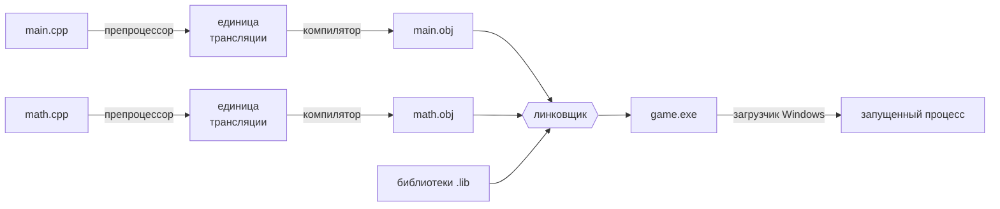

# 00.2 Как исходник становится программой

> [!abstract] О чём урок
> - четыре этапа на пути от `.cpp` к работающей программе: **препроцессор → компилятор → линковщик → загрузчик**;
> - что такое **единица трансляции** и почему компилятор не видит соседние файлы;
> - что лежит внутри `.obj` и `.exe` и зачем C++ «искажает» имена функций;
> - чем **Debug**-сборка отличается от **Release**.
>
> Этот урок объясняет 90% непонятных ошибок, которые встретятся тебе в ближайшие месяцы. Когда видишь ошибку, первым делом спроси себя: **на каком этапе она возникла?**

## Общая картина



Ключевое наблюдение: **каждый `.cpp` файл компилируется отдельно и независимо**. Компилятор, обрабатывая `main.cpp`, ничего не знает о существовании `math.cpp`. Собрать всё вместе — работа линковщика. Пока это звучит как техническая деталь, но из неё вытекает вся система заголовочных файлов C++, которую мы разберём в [[02.5 Многофайловые программы и линковщик]].

Проследим путь маленькой программы:

```cpp
#include <print>

int square(int x) {
    return x * x;
}

int main() {
    std::println("Привет, движок! 7 * 7 = {}", square(7));
}
```

## Этап 1. Препроцессор

Препроцессор — простой **текстовый** процессор, который работает до компилятора и ничего не знает о C++. Он обрабатывает строки, начинающиеся с `#` (**директивы**):

| Директива | Что делает |
|---|---|
| `#include <файл>` | **Вставляет** содержимое файла на место директивы. Буквально копирует текст. |
| `#define ИМЯ значение` | Заменяет все последующие вхождения `ИМЯ` на `значение` (макрос). |
| `#if` / `#ifdef` / `#endif` | Включает или выкидывает куски кода в зависимости от условия. |
| `#pragma` | Особые указания конкретному компилятору. |

Наша программа занимает 9 строк. Но `#include <print>` тянет за собой заголовок `print`, тот подключает `format`, тот подключает `string`, и так далее. Я прогнал наш файл через препроцессор MSVC (флаг `/P`), и вот результат:

| Файл | Размер |
|---|---|
| `hello.cpp` (исходник) | 9 строк |
| `hello.i` (после препроцессора) | **100 654 строки, 3,4 МБ** |

Сто тысяч строк, и всё это компилятор честно разбирает **для каждого `.cpp` файла**, где есть `#include <print>`. Вот почему C++ компилируется медленно.

> [!deep] Под капотом: зачем вообще нужен `#include`
> Компилятору, чтобы скомпилировать вызов `std::println(...)`, нужно знать, **что** такое `std::println`: сколько у функции параметров, какие у них типы, что она возвращает. Язык C (а за ним и C++) родом из 1970-х, когда у компьютеров было мало памяти, и компилятор не мог держать в голове весь проект. Решение было такое: каждый файл компилируется отдельно, а нужные **объявления** вставляются в него текстом из заголовочных файлов (`.h`). Отсюда и все особенности, которые мы разберём в модуле 02.

> [!compare] Как это в C#, Go и Python
> - **C#**: компилятор Roslyn видит всю сборку (assembly) целиком, а о других сборках узнаёт из **метаданных** в DLL. Никаких заголовков.
> - **Go**: пакеты компилируются по отдельности, но компилятор читает готовую «сводку экспорта» скомпилированного пакета, а не исходники.
> - **Python**: `import` выполняет модуль во время работы программы.
> - **C++**: текстовая вставка. В C++20 появились **модули** (`import std;`), которые решают эту проблему. Но поддержка в инструментах пока неровная, поэтому в курсе мы используем классический `#include` (его ты встретишь в любом существующем коде).

## Этап 2. Компилятор

То, что получилось после препроцессора (один `.cpp` со всеми вставленными заголовками), называется **единица трансляции** (translation unit). Компилятор превращает её в **объектный файл** (`.obj` в Windows, `.o` в Linux).

Внутри компилятор проходит через несколько фаз:

1. **Лексический анализ**: текст разбивается на токены (`int`, `square`, `(`, `x`, …).
2. **Синтаксический анализ**: из токенов строится дерево программы. Здесь ловятся ошибки вроде пропущенной `;`.
3. **Семантический анализ**: проверка типов, выбор нужной перегрузки функции, подстановка шаблонов. Отсюда ошибки «нельзя преобразовать `const char*` в `int`».
4. **Оптимизация** (в Release-сборке): выбрасывание лишнего, встраивание функций, векторизация.
5. **Генерация кода**: машинные инструкции для x64.

### Что внутри .obj

Объектный файл содержит:
- **машинный код** функций;
- **данные** (строковые литералы, глобальные переменные);
- **таблицу символов**: список того, что этот файл **определяет** (например, функцию `square`), и того, что он **использует, но не определяет** (например, функции стандартной библиотеки).

Вот что показывает утилита `dumpbin /symbols hello.obj` (вывод сокращён):

```
8CC 00000000 SECT6  notype ()    External     | ?square@@YAHH@Z (int __cdecl square(int))
8CD 00000020 SECT6  notype ()    External     | main
```

Обрати внимание на странное имя `?square@@YAHH@Z`. Это **декорированное** (mangled) имя функции.

> [!deep] Под капотом: декорирование имён
> В C++ можно объявить несколько функций с одним именем и разными параметрами (**перегрузка**):
> ```cpp
> int square(int x);
> double square(double x);
> ```
> Но на уровне машинного кода и объектных файлов у функции есть только имя, и два одинаковых имени конфликтуют. Поэтому компилятор кодирует в имени типы параметров и возвращаемого значения:
> - `?square@@YAHH@Z` означает `int square(int)`: `H` — это `int`;
> - `?square@@YANN@Z` означает `double square(double)`: `N` — это `double`.
>
> У MSVC есть утилита `undname`, которая расшифровывает такие имена:
> ```
> > undname ?square@@YAHH@Z
> is :- "int __cdecl square(int)"
> ```
> Функция `main` не декорирована: она особая, её ищет код запуска программы.
>
> Декорированные имена ты будешь видеть в **ошибках линковщика**. Не пугайся их: рядом MSVC всегда пишет человеческую расшифровку.

## Этап 3. Линковщик

**Линковщик** (компоновщик, linker; у MSVC это `link.exe`) собирает все `.obj` файлы и библиотеки в один исполняемый файл:

1. Берёт все объектные файлы проекта.
2. Для каждого используемого символа ищет, где он определён: в другом `.obj` или в библиотеке.
3. Склеивает машинный код и подставляет настоящие адреса вместо ссылок на символы.
4. Записывает результат в формате **PE** (Portable Executable), формате `.exe` и `.dll` в Windows.

Две классические ошибки линковщика, которые ты обязательно встретишь:

| Ошибка | Смысл | Типичная причина |
|---|---|---|
| **LNK2019**: unresolved external symbol | Символ используется, но нигде не определён | Объявил функцию, но забыл написать её тело; не подключил `.cpp` или библиотеку в CMake |
| **LNK2005**: symbol already defined | Символ определён дважды | Написал тело функции в заголовке, и он подключён в два `.cpp` |

> [!tip] Как отличить ошибку компилятора от ошибки линковщика
> - Коды ошибок компилятора MSVC начинаются с **C** (`C2065`, `C2440`), и в них указан **файл и строка**.
> - Коды ошибок линковщика начинаются с **LNK** (`LNK2019`), и строки в них нет: линковщик работает с объектными файлами, а не с текстом. Он знает только имена символов.

### Библиотеки

| Тип | Расширение | Что это |
|---|---|---|
| **Статическая библиотека** | `.lib` | Архив `.obj` файлов. Линковщик **копирует** нужный код прямо в твой `.exe`. |
| **Динамическая библиотека** | `.dll` | Отдельный файл, который загружается **при запуске** программы. Код не копируется в `.exe`. |
| **Библиотека импорта** | `.lib` | Маленький файл-«справка» для линковщика: какие функции есть в такой-то DLL. |

Да, у статической библиотеки и библиотеки импорта одинаковое расширение `.lib`. Спасибо, Microsoft.

## Этап 4. Запуск

Когда ты запускаешь `hello.exe`:

1. **Загрузчик Windows** читает PE-файл, размещает код и данные в памяти нового процесса.
2. Загружает все **DLL**, от которых зависит программа (и DLL, от которых зависят они).
3. Передаёт управление **коду запуска C-рантайма** (CRT, функция `mainCRTStartup`). Это не твой код: его добавил линковщик. Он инициализирует кучу, стандартный ввод-вывод, глобальные объекты.
4. CRT вызывает твою функцию `main`.
5. Когда `main` возвращает значение, CRT уничтожает глобальные объекты и завершает процесс с этим значением в качестве **кода возврата**.

> [!tip] Код возврата
> Значение, которое возвращает `main`, — это **код возврата** процесса. `0` значит «успех», всё остальное — «ошибка». Если `return` в `main` не написан, компилятор считает, что там `return 0;` (это исключение действует только для `main`!). В PowerShell код возврата последней программы лежит в переменной `$LASTEXITCODE`.

### От каких DLL зависит программа

Вот что показывает `dumpbin /dependents` для нашей программы, собранной через CMake:

| Debug-сборка | Release-сборка |
|---|---|
| `MSVCP140D.dll`: стандартная библиотека C++ (отладочная) | `MSVCP140.dll` |
| `VCRUNTIME140D.dll`: рантайм компилятора (отладочный) | `VCRUNTIME140.dll` |
| `ucrtbased.dll`: стандартная библиотека C (отладочная) | `api-ms-win-crt-*.dll` (UCRT, часть Windows) |
| `KERNEL32.dll`: ядро WinAPI | `KERNEL32.dll` |

> [!warning] Не отдавай друзьям Debug-сборку
> DLL с буквой **D** на конце есть только на компьютерах, где установлена Visual Studio. Если отправить другу Debug-версию игры, она не запустится с ошибкой «не найден MSVCP140D.dll». А Release-версии нужен пакет **Microsoft Visual C++ Redistributable**, который ставит почти каждая игра. Вот почему ты видел его в установщиках Steam-игр.

## Debug и Release

Одна и та же программа может быть собрана по-разному. Две главные **конфигурации**:

| | **Debug** | **Release** |
|---|---|---|
| Оптимизации | выключены (`/Od`) | включены (`/O2`) |
| Отладочная информация | полная, файл `.pdb` | обычно нет (или есть в `RelWithDebInfo`) |
| Проверки во время работы | есть: неинициализированные переменные (`/RTC1`), выход за границы в контейнерах STL | нет |
| `assert(...)` | работают | вырезаются |
| Размер нашего `hello.exe` | **1,2 МБ** (+ 4 МБ `.pdb`) | **240 КБ** |
| Скорость | медленно: иногда в 10–100 раз | быстро |

В Debug-сборке код соответствует исходнику строка в строку. Поэтому его удобно отлаживать: каждая переменная лежит в памяти, каждая строка выполняется по порядку. В Release компилятор переставляет, объединяет и выбрасывает код.

> [!deep] Под капотом: что сделал оптимизатор с нашей программой
> Я попросил MSVC показать ассемблер Release-версии (флаг `/FA`). Функции `square` в `main` **нет**: компилятор сам вычислил `square(7)` при компиляции и подставил готовый ответ:
> ```asm
> mov  DWORD PTR $T5[rbp-81], 49   ; 00000031H
> ```
> Это два приёма оптимизации сразу: **встраивание** (inlining: тело функции подставляется на место вызова) и **свёртка констант** (constant folding: вычисление выражений из констант во время компиляции). В Debug-сборке там честный вызов функции `call square`.

> [!engine] Debug, Development, Shipping
> В движках обычно больше двух конфигураций. В Unreal Engine:
> - **Debug**: без оптимизаций, всё проверяется; игра работает медленно;
> - **Development**: оптимизации включены, но ассерты, консоль разработчика и логирование остались. Основная рабочая конфигурация;
> - **Shipping**: всё лишнее вырезано, это версия для игроков.
>
> В практикуме этого модуля ты своими глазами увидишь, насколько Debug медленнее Release на «игровом» коде.

## Почему C++ компилируется долго и что с этим делают

Вспомни 100 тысяч строк от одного `#include <print>`. В проекте из 500 `.cpp` файлов, каждый из которых подключает тяжёлые заголовки, компилятор обработает **десятки миллионов** строк.

> [!engine] Как движки борются со временем сборки
> - **Предварительные объявления** (forward declarations): не подключать заголовок, если достаточно знать, что тип существует. Разберём в модуле 02.
> - **Предкомпилированные заголовки** (PCH): тяжёлые заголовки компилируются один раз, результат сохраняется на диск.
> - **Unity builds**: много `.cpp` склеиваются в один большой, и общие заголовки разбираются один раз. Unreal Engine делает так по умолчанию.
> - **Модули C++20**: решение проблемы на уровне языка.
> - **Распределённая сборка** (Incredibuild, FASTBuild): компиляция на десятках машин сразу.

> [!quiz]- Проверь себя
> 1. Назови четыре этапа от исходника до работающей программы.
> 2. Что такое единица трансляции?
> 3. Ошибка `LNK2019: unresolved external symbol "int __cdecl damage(int)"`. На каком этапе она возникла и что, скорее всего, случилось?
> 4. Ошибка `C2065: 'helth': undeclared identifier` в `main.cpp`, строка 12. На каком этапе?
> 5. Зачем C++ декорирует имена функций?
> 6. Почему нельзя отдать другу Debug-сборку игры?
>
> > [!success]- Ответы
> > 1. Препроцессор → компилятор → линковщик → загрузчик ОС.
> > 2. Один `.cpp` файл после работы препроцессора, со всеми вставленными `#include`. Компилятор обрабатывает каждую единицу трансляции независимо.
> > 3. На этапе линковки. Функция `damage(int)` где-то объявлена и вызвана, но её **определение** (тело) не найдено: забыли написать, или `.cpp` с ней не добавлен в сборку.
> > 4. На этапе компиляции (код `C…`, есть файл и строка). Опечатка: переменной `helth` не существует.
> > 5. Чтобы поддержать перегрузку функций (и пространства имён, классы): на уровне объектных файлов у каждой функции должно быть уникальное имя, поэтому в него кодируются типы параметров.
> > 6. Она зависит от отладочных DLL (`MSVCP140D.dll` и др.), которые есть только там, где установлена Visual Studio. Кроме того, она медленная.

> [!interview] Вопрос с собеседования
> **«Что происходит, когда вы нажимаете "собрать"?»** Нужно рассказать про препроцессор, компиляцию единиц трансляции по отдельности, объектные файлы и таблицы символов, линковку и разрешение символов. Бонусные очки: декорирование имён, разница между статической и динамической линковкой, код запуска CRT.

---
[[00.1 Что такое C++ и почему движки пишут на нём|← Что такое C++]] · [[🏠 Главная|🏠]] · [[00.3 Установка и проверка инструментов|Далее: Установка и проверка инструментов →]]
