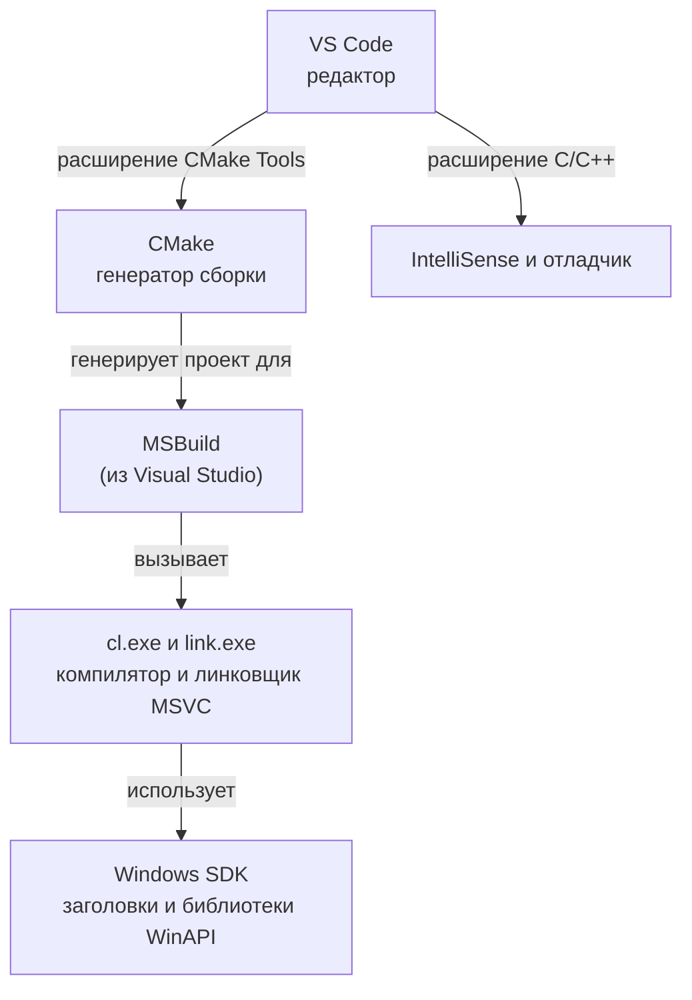

# 00.3 Установка и проверка инструментов

> [!abstract] О чём урок
> - из каких частей состоит наше рабочее окружение и зачем каждая;
> - как проверить, что всё установлено правильно;
> - какие расширения VS Code нужны, а какие **мешают**.
>
> Скорее всего, у тебя уже всё стоит. Тогда этот урок — чек-лист: пройди по нему и убедись.

## Из чего состоит окружение



| Компонент | Зачем | Откуда |
|---|---|---|
| **Компилятор MSVC** (`cl.exe`), линковщик (`link.exe`), стандартная библиотека | Превращает код в программу | Visual Studio 2026 (рабочая нагрузка C++) |
| **Windows SDK** | Заголовки и библиотеки WinAPI, Direct3D | Там же |
| **MSBuild** | Система сборки, которой CMake поручает компиляцию | Там же |
| **CMake** | Описание проекта и генерация файлов сборки | cmake.org или вместе с Visual Studio |
| **VS Code** | Редактор, в котором мы работаем | code.visualstudio.com |
| Расширение **C/C++** | Подсветка, автодополнение (IntelliSense), **отладчик** | Магазин расширений VS Code |
| Расширение **CMake Tools** | Кнопки «собрать», «запустить», «отлаживать» | Магазин расширений VS Code |

> [!question] Зачем Visual Studio, если мы работаем в VS Code?
> Visual Studio (фиолетовая) — это большая IDE, а **внутри неё лежит компилятор MSVC** со всеми библиотеками. Саму IDE мы не открываем, нам нужны только её «внутренности». Есть и вариант без IDE, пакет **Build Tools for Visual Studio**: только компилятор и инструменты. Если Visual Studio уже стоит, ничего менять не надо.
>
> VS Code — просто редактор. Своего компилятора у него нет, он вызывает внешние инструменты через расширения.

> [!compare] Почему MSVC, а не GCC/MinGW или Clang?
> - **MSVC** — родной компилятор Windows. На нём собирается большинство игр под Windows и Xbox, у него лучший отладчик в Windows, и с ним без танцев работают WinAPI и Direct3D.
> - **MinGW (GCC)** — порт линуксового GCC. Хорош для кроссплатформенности, но для Windows-геймдева это путь с лишними сложностями.
> - **Clang** — отличный компилятор, и Visual Studio даже ставит его (`clang-cl`). Можно будет попробовать позже, сравнить сообщения об ошибках и скорость кода.

## Шаг 1. Visual Studio 2026 и компоненты C++

Открой **Visual Studio Installer** (через меню Пуск) → у установленной Visual Studio нажми **Изменить**.

Во вкладке **Рабочие нагрузки** должна стоять галочка:
- ☑ **Разработка классических приложений на C++** (*Desktop development with C++*)

Справа, в **Сведениях об установке** этой нагрузки, проверь, что отмечены (названия в установщике могут немного отличаться, поэтому в скобках английский вариант):
- ☑ **Средства сборки MSVC для x64/x86, последняя версия** (*MSVC Build Tools for x64/x86 (Latest)*) — сам компилятор;
- ☑ **Windows 11 SDK** (любая свежая версия);
- ☑ **C++ AddressSanitizer** — понадобится в модуле 03 для поиска ошибок памяти;
- ☑ **Средства CMake C++ для Windows** (*C++ CMake tools for Windows*) — необязательно, но полезно: ставит CMake и Ninja внутрь Visual Studio.

## Шаг 2. CMake

Нужен CMake **версии 4.2 или новее**: только начиная с неё CMake знает о Visual Studio 2026. Если CMake не установлен или устарел, установи его с [cmake.org/download](https://cmake.org/download/) (Windows x64 Installer, при установке выбери «Add CMake to the PATH») или одной командой в терминале:

```powershell
winget install Kitware.CMake
```

## Шаг 3. VS Code и расширения

В VS Code открой панель расширений (`Ctrl+Shift+X`) и убедись, что установлены:

| Расширение | Издатель | Обязательно? |
|---|---|---|
| **C/C++** | Microsoft | да |
| **CMake Tools** | Microsoft | да |
| C/C++ Themes | Microsoft | по желанию |

> [!warning] Расширения, которые мешают
> Расширения **Code Runner** (formulahendry) и **C/C++ Runner** (franneck94) пытаются компилировать C++ сами, в обход CMake, и обычно ищут компилятор GCC, которого у нас нет. Из-за них появляются лишние кнопки ▶ в углу редактора, которые выдают непонятные ошибки.
>
> Если они у тебя стоят, отключи их **для рабочей области курса**: в панели расширений нажми на шестерёнку у расширения → **Отключить (рабочая область)**. Делать это нужно после того, как откроешь папку проекта в уроке [[00.5 Проект курса в VS Code]]. Удалять их совсем не обязательно: для других проектов они могут пригодиться.

## Шаг 4. Проверка

Открой терминал в VS Code (`` Ctrl+` ``) и выполни по очереди:

```powershell
cmake --version
```
Ожидается `cmake version 4.2` или новее.

```powershell
& "${env:ProgramFiles(x86)}\Microsoft Visual Studio\Installer\vswhere.exe" -latest -products * -requires Microsoft.VisualStudio.Component.VC.Tools.x86.x64 -property displayName
```
Ожидается `Visual Studio Community 2026`. Если вывод пустой, значит компилятор C++ не установлен; вернись к шагу 1.

```powershell
cl
```
Скорее всего, ты увидишь ошибку **«Имя "cl" не распознано…»**. **Это нормально!**

> [!deep] Под капотом: почему `cl` «не найден», хотя он установлен
> Visual Studio специально **не добавляет** компилятор в системную переменную `PATH`. На одном компьютере могут стоять несколько версий Visual Studio и компиляторов для разных архитектур (x86, x64, ARM64), и глобальный `PATH` их бы перепутал. Вместо этого есть скрипт `vcvars64.bat` (и «Developer PowerShell»), который настраивает окружение для **одного** терминала.
>
> CMake поступает умнее: он сам находит установленную Visual Studio через утилиту `vswhere.exe` (её мы только что запускали) и генерирует проект, в котором уже прописаны все пути. Поэтому для работы через CMake `cl` в `PATH` не нужен.
>
> Для экспериментов «под капотом» (посмотреть объектный файл, ассемблер, зависимости `.exe`) мы в уроке [[00.5 Проект курса в VS Code]] добавим в VS Code отдельный терминал **Developer PowerShell**, в котором `cl`, `link` и `dumpbin` доступны.

## Если что-то пошло не так

| Симптом | Причина и решение |
|---|---|
| `cmake` не распознан | CMake не установлен или не добавлен в `PATH`. Переустанови с галочкой «Add to PATH» и **перезапусти VS Code**: он читает `PATH` только при старте. |
| `cmake --version` показывает 3.x | Старый CMake не знает Visual Studio 2026. Обнови. |
| `vswhere` выдаёт пустую строку | Не установлена рабочая нагрузка C++ (шаг 1). |
| Всё установлено, но VS Code не видит | Закрой **все** окна VS Code и открой заново. |

> [!quiz]- Проверь себя
> 1. Зачем нам Visual Studio, если код пишем в VS Code?
> 2. Почему команда `cl` в обычном терминале не работает и почему это не мешает сборке?
> 3. Какие два расширения VS Code обязательны и за что отвечает каждое?
>
> > [!success]- Ответы
> > 1. Из неё мы берём компилятор MSVC, линковщик, стандартную библиотеку, Windows SDK и MSBuild. Сама IDE не используется.
> > 2. Visual Studio намеренно не добавляет компилятор в глобальный `PATH`. CMake находит Visual Studio сам (через `vswhere`) и генерирует проект с правильными путями.
> > 3. **C/C++**: IntelliSense (подсветка ошибок, автодополнение, переход к определению) и отладчик. **CMake Tools**: конфигурация, сборка, запуск и отладка CMake-проектов.

---
[[00.2 Как исходник становится программой|← Как исходник становится программой]] · [[🏠 Главная|🏠]] · [[00.4 CMake с нуля|Далее: CMake с нуля →]]
