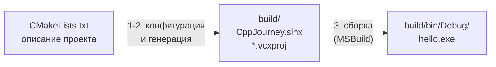

# 00.4 CMake с нуля

> [!abstract] О чём урок
> - зачем нужна система сборки и почему CMake называют «генератором»;
> - три шага CMake: **конфигурация → генерация → сборка**;
> - как читать и писать `CMakeLists.txt`: цели (**targets**), переменные, подкаталоги;
> - что такое **генератор**, **конфигурация сборки** и **пресеты**.
>
> В следующем уроке мы применим всё это к настоящему проекту в VS Code. Здесь разбираемся, **как это работает**, чтобы потом не нажимать кнопки наугад.

## Зачем вообще система сборки

Скомпилировать один файл можно и руками:

```powershell
cl /std:c++latest /EHsc /utf-8 hello.cpp
```

А теперь представь проект движка:
- сотни `.cpp` файлов, и каждый нужно скомпилировать с одинаковыми флагами;
- после изменения одного файла хочется перекомпилировать **только его**, а не всё (это называется **инкрементальная сборка**);
- нужны две конфигурации, Debug и Release, с разными флагами;
- часть кода собирается в библиотеку, а игра подключает её;
- кто-то в команде работает в Visual Studio, кто-то в VS Code, а сервер сборки — на Linux.

Для этого существуют **системы сборки**: MSBuild (Visual Studio), Make, Ninja. Каждая со своим форматом файлов: MSBuild хочет `.vcxproj`, Make хочет `Makefile`, Ninja хочет `build.ninja`.

**CMake** решает проблему на уровень выше. Ты **один раз** описываешь проект в файле `CMakeLists.txt`, а CMake **генерирует** из этого описания файлы для нужной системы сборки. Поэтому CMake называют **генератором систем сборки** (meta-build system). Сам CMake ничего не компилирует.

> [!compare] Аналогия
> | Язык | Описание проекта | Сборка |
> |---|---|---|
> | C# | `.csproj` | `dotnet build` (MSBuild) |
> | Go | `go.mod` | `go build` |
> | Python | `pyproject.toml` | `pip install` / `python -m build` |
> | **C++** | `CMakeLists.txt` | `cmake --build` → MSBuild / Ninja / Make |
>
> В C# и Go система сборки встроена в инструментарий языка. В C++ стандартной системы сборки **нет**. CMake — фактический стандарт индустрии: его используют большинство открытых C++ проектов, Visual Studio, CLion и VS Code понимают его напрямую.

## Три шага



1. **Конфигурация** (configure). CMake выполняет `CMakeLists.txt` как скрипт: находит компилятор, проверяет, что он работает, собирает список целей и их настроек. Результаты поиска запоминаются в файле `CMakeCache.txt`.
2. **Генерация** (generate). По собранной информации CMake пишет файлы проекта для выбранной системы сборки. Для Visual Studio это `.slnx` (решение) и `.vcxproj` (по одному на каждую цель).
3. **Сборка** (build). Система сборки (у нас MSBuild) вызывает компилятор и линковщик.

Шаги 1 и 2 всегда идут вместе, поэтому их часто называют одним словом: «конфигурация». Повторять их нужно только когда изменился `CMakeLists.txt`. Шаг 3 повторяется после каждого изменения кода.

> [!tip] Сборка вне дерева исходников
> Все сгенерированные файлы и результаты сборки CMake кладёт в **отдельную папку**, обычно `build/`. Исходники остаются чистыми, а если со сборкой что-то пошло не так, папку `build/` можно просто удалить: CMake создаст всё заново. Это называется **out-of-source build**, и так делают всегда.

## Минимальный CMakeLists.txt

```cmake
cmake_minimum_required(VERSION 3.30)
project(Hello LANGUAGES CXX)

add_executable(hello main.cpp)
```

Разберём построчно.

**`cmake_minimum_required(VERSION 3.30)`** — минимальная версия CMake для этого проекта. Строка не только проверяет версию, но и **включает поведение** этой версии. CMake развивается 25 лет, и чтобы старые проекты не ломались, многие изменения поведения (они называются **политиками**, policies) включаются только если проект «объявил», что знает о них. Эта строка всегда пишется первой.

**`project(Hello LANGUAGES CXX)`** — имя проекта и используемые языки. `CXX` означает C++ (`C` означало бы язык C). На этой строке CMake ищет компилятор, и в выводе ты увидишь `-- The CXX compiler identification is MSVC 19.51...`.

**`add_executable(hello main.cpp)`** — создать **цель** (target) с именем `hello`, исполняемый файл из исходника `main.cpp`. Если исходников несколько, они перечисляются через пробел:

```cmake
add_executable(game main.cpp player.cpp map.cpp)
```

## Цели — главное понятие CMake

**Цель** (target) — это то, что собирается: программа (`add_executable`) или библиотека (`add_library`). У каждой цели есть **свойства**: исходники, флаги компиляции, пути поиска заголовков, библиотеки для линковки. Свойства задаются командами `target_*`:

```cmake
add_executable(game main.cpp)

# флаги компилятора только для этой цели
target_compile_options(game PRIVATE /W4)

# где искать заголовочные файлы
target_include_directories(game PRIVATE include)

# слинковать с библиотекой engine (тоже цель CMake)
target_link_libraries(game PRIVATE engine)
```

Слово `PRIVATE` (а ещё бывают `PUBLIC` и `INTERFACE`) означает, распространяется ли свойство на тех, кто зависит от цели. Это важно для библиотек, подробно разберём в [[02.6 CMake — библиотеки и структура проекта]].

> [!tip] «Современный» CMake
> В старых проектах и туториалах ты встретишь глобальные команды вроде `include_directories(...)` и `add_definitions(...)`, которые действуют на **все** цели сразу. Современный подход: настраивать каждую цель через `target_*`. Тогда видно, откуда у цели какой флаг, а зависимости между целями описаны явно.

## Переменные и условия

CMake — это ещё и простой скриптовый язык.

```cmake
set(GAME_NAME "Ember Doom")             # создать переменную
message(STATUS "Собираем ${GAME_NAME}") # вывести сообщение при конфигурации

if(MSVC)                                # MSVC — встроенная переменная: истина, если компилятор MSVC
    message(STATUS "Компилятор MSVC")
endif()
```

Особенности языка CMake, о которые спотыкаются все:
- **Всё — строки.** Даже числа и списки.
- **Список** — это строка с элементами через `;`: `set(SOURCES main.cpp map.cpp)` создаёт строку `"main.cpp;map.cpp"`.
- **Имена команд не чувствительны к регистру** (`add_executable` = `ADD_EXECUTABLE`), а **имена переменных чувствительны**. Принято писать команды маленькими буквами.
- Обращение к несуществующей переменной даёт пустую строку, а не ошибку. Опечатка в имени переменной молча превращается в пустоту.

Полезные встроенные переменные:

| Переменная | Значение |
|---|---|
| `CMAKE_SOURCE_DIR` | Корень проекта (где лежит главный `CMakeLists.txt`) |
| `CMAKE_BINARY_DIR` | Корень папки сборки (`build/`) |
| `CMAKE_CURRENT_SOURCE_DIR` | Папка текущего `CMakeLists.txt` |
| `CMAKE_CXX_STANDARD` | Версия стандарта C++ для всех целей |
| `CMAKE_RUNTIME_OUTPUT_DIRECTORY` | Куда класть готовые `.exe` |

## Стандарт C++ и флаги компилятора

Вот начало `CMakeLists.txt`, которое мы будем использовать в курсе:

```cmake
cmake_minimum_required(VERSION 3.30)
project(CppJourney LANGUAGES CXX)

# Стандарт C++23, строго, без расширений компилятора
set(CMAKE_CXX_STANDARD 23)
set(CMAKE_CXX_STANDARD_REQUIRED ON)
set(CMAKE_CXX_EXTENSIONS OFF)

# Все .exe складываются в build/bin/<конфигурация>/
set(CMAKE_RUNTIME_OUTPUT_DIRECTORY ${CMAKE_BINARY_DIR}/bin)

if(MSVC)
    add_compile_options(/W4 /permissive- /utf-8 /Zc:__cplusplus)
endif()
```

- `CMAKE_CXX_STANDARD 23` — компилировать по стандарту C++23. Для MSVC CMake превращает это во флаг `/std:c++latest` («самый свежий поддерживаемый стандарт»).
- `CMAKE_CXX_STANDARD_REQUIRED ON` — если компилятор не умеет C++23, остановиться с ошибкой, а не молча откатиться на старый стандарт.
- `CMAKE_CXX_EXTENSIONS OFF` — не использовать нестандартные расширения компилятора.

Флаги MSVC:

| Флаг | Что делает |
|---|---|
| `/W4` | Уровень предупреждений 4 из 4. Компилятор будет ворчать на всё подозрительное, **и это хорошо**: каждое предупреждение — потенциальный баг. |
| `/permissive-` | Строгое соответствие стандарту. Исторически MSVC пропускал много нестандартного кода; этот флаг выключает поблажки. |
| `/utf-8` | Исходники и строки в программе в кодировке UTF-8. Без него кириллица в строках превратится в кашу. |
| `/Zc:__cplusplus` | Заставляет макрос `__cplusplus` показывать настоящую версию стандарта. |

> [!deep] Под капотом: почему `/Zc:__cplusplus`
> Макрос `__cplusplus` должен содержать версию стандарта: `201703L` для C++17, `202002L` для C++20 и так далее. Но MSVC **по умолчанию всегда** пишет туда `199711L` (C++98), что бы ни было включено! Так сделано для совместимости со старым кодом, который неправильно проверял этот макрос. Флаг `/Zc:__cplusplus` включает честное значение. Это хороший пример того, как исторические решения десятилетиями живут в инструментах.

> [!note] `add_compile_options` против `target_compile_options`
> Только что я сказал, что современный CMake настраивает каждую цель отдельно, а сам использую глобальную `add_compile_options`. В учебном проекте с десятками маленьких программ это разумный компромисс: флаги предупреждений нужны всем. В проекте движка мы сделаем аккуратнее.

## Подкаталоги

Большой проект разбивают на папки, и у каждой папки свой `CMakeLists.txt`:

```
practice/
├── CMakeLists.txt          ← главный: настройки + add_subdirectory(...)
├── m00_setup/
│   ├── CMakeLists.txt      ← add_executable(m00_hello hello.cpp)
│   └── hello.cpp
└── m01_basics/
    ├── CMakeLists.txt
    └── ...
```

Главный файл подключает подпапки:

```cmake
add_subdirectory(m00_setup)
add_subdirectory(m01_basics)
```

> [!warning] Имена целей глобальны
> Все цели во всём проекте живут в одном пространстве имён. Если в `m00_setup` и в `m01_basics` будет по цели `hello`, CMake выдаст ошибку. Поэтому в курсе имена целей начинаются с номера модуля: `m00_hello`, `m01_guess`.

## Генераторы и конфигурации сборки

**Генератор** определяет, для какой системы сборки CMake пишет файлы. Нас интересуют два:

| Генератор | Система сборки | Особенности |
|---|---|---|
| **Visual Studio 18 2026** | MSBuild | Работает «из коробки», сам находит компилятор. Мульти-конфигурационный. **Используем в курсе.** |
| **Ninja** | Ninja | Очень быстрый, популярен в больших проектах. Требует, чтобы окружение компилятора было настроено заранее (Developer PowerShell). |

**Конфигурация сборки** — набор флагов для определённой цели (отладка или скорость). Стандартные конфигурации CMake и флаги, которые они дают для MSVC:

| Конфигурация | Флаги MSVC | Для чего |
|---|---|---|
| `Debug` | `/Od /Ob0 /RTC1` + отладочная информация | Отладка: без оптимизаций, с проверками |
| `Release` | `/O2 /Ob2 /DNDEBUG` | Финальная сборка: максимум скорости |
| `RelWithDebInfo` | `/O2 /Ob1 /DNDEBUG` + отладочная информация | Быстро, но всё ещё можно отлаживать. Аналог Development в Unreal |
| `MinSizeRel` | `/O1 /Ob1 /DNDEBUG` | Минимальный размер файла |

(`/O` — уровень оптимизации, `/Ob` — насколько агрессивно встраивать функции, `/DNDEBUG` выключает `assert`.)

> [!deep] Под капотом: мульти- и одноконфигурационные генераторы
> **Одноконфигурационный** генератор (Ninja, Make) выбирает конфигурацию **при конфигурации** через переменную `CMAKE_BUILD_TYPE`: одна папка сборки на одну конфигурацию.
>
> **Мульти-конфигурационный** генератор (Visual Studio, Ninja Multi-Config) генерирует сразу все конфигурации, а нужная выбирается **при сборке**: `cmake --build build --config Release`. Результаты лежат в подпапках `Debug/`, `Release/`.
>
> Частая ошибка: задать `CMAKE_BUILD_TYPE=Release` при генераторе Visual Studio и удивляться, что собирается Debug. С мульти-конфигурационными генераторами эта переменная **игнорируется**.

## Командная строка CMake

VS Code будет вызывать эти команды за нас, но полезно знать, что именно происходит:

```powershell
# 1-2. Конфигурация и генерация: исходники в текущей папке (.), сборка в build/
cmake -S . -B build -G "Visual Studio 18 2026" -A x64

# 3. Сборка в конфигурации Debug
cmake --build build --config Debug

# Запуск (для минимального проекта из начала урока)
.\build\Debug\hello.exe
```

Если в `CMakeLists.txt` задана `CMAKE_RUNTIME_OUTPUT_DIRECTORY`, как в проекте курса, программа окажется в `build\bin\Debug\`.

`-S` — папка исходников (source), `-B` — папка сборки (build), `-G` — генератор, `-A x64` — архитектура.

## Пресеты

Писать длинные команды каждый раз неудобно, а держать настройки в голове ненадёжно. Поэтому настройки конфигурации записывают в файл **`CMakePresets.json`** рядом с `CMakeLists.txt`:

```json
{
  "version": 6,
  "configurePresets": [
    {
      "name": "msvc",
      "displayName": "MSVC x64 (Visual Studio 2026)",
      "generator": "Visual Studio 18 2026",
      "architecture": "x64",
      "binaryDir": "${sourceDir}/build"
    }
  ],
  "buildPresets": [
    { "name": "debug",   "displayName": "Debug",   "configurePreset": "msvc", "configuration": "Debug" },
    { "name": "release", "displayName": "Release", "configurePreset": "msvc", "configuration": "Release" }
  ]
}
```

- **`configurePresets`** — как конфигурировать: генератор, архитектура, папка сборки.
- **`buildPresets`** — как собирать: на основе какого configure-пресета и в какой конфигурации.

Теперь команды становятся короткими:

```powershell
cmake --preset msvc              # конфигурация
cmake --build --preset debug     # сборка Debug
cmake --build --preset release   # сборка Release
```

А главное, этот файл понимает **CMake Tools в VS Code**: он покажет пресеты в своей панели, и ты будешь просто выбирать их мышкой.

## Что лежит в папке build

| Файл/папка | Что это |
|---|---|
| `CMakeCache.txt` | **Кэш**: найденный компилятор, пути, значения переменных. Читается при каждой повторной конфигурации. |
| `CMakeFiles/` | Служебные файлы CMake: результаты проверок компилятора и т.д. |
| `CppJourney.slnx` | Решение Visual Studio (можно открыть в Visual Studio, если захочется). |
| `*.vcxproj` | Проекты MSBuild, по одному на цель. |
| `bin/Debug/`, `bin/Release/` | Готовые программы (благодаря `CMAKE_RUNTIME_OUTPUT_DIRECTORY`). |

> [!tip] Универсальное лекарство
> Если CMake ведёт себя странно (не видит компилятор, держится за старые настройки, сыплет непонятными ошибками), **удали папку `build/`** и сконфигурируй заново. В VS Code для этого есть команда **CMake: Delete Cache and Reconfigure**. Это аналог «выключить и включить», и он помогает в 80% случаев.

> [!quiz]- Проверь себя
> 1. Почему CMake называют генератором систем сборки?
> 2. Что происходит на шаге конфигурации и когда его нужно повторять?
> 3. Что такое цель (target)? Назови две команды, создающие цели.
> 4. В проекте две цели с именем `test` в разных папках. Что будет?
> 5. Ты задал `-DCMAKE_BUILD_TYPE=Release`, используешь генератор Visual Studio, но `.exe` оказался в папке `Debug`. Почему?
> 6. Чем отличаются `configurePresets` и `buildPresets`?
>
> > [!success]- Ответы
> > 1. Он сам ничего не компилирует, а генерирует файлы для настоящих систем сборки (MSBuild, Ninja, Make) из единого описания `CMakeLists.txt`.
> > 2. CMake выполняет `CMakeLists.txt`, находит компилятор, собирает список целей и пишет файлы проекта. Повторять нужно при изменении `CMakeLists.txt` (VS Code делает это автоматически при сохранении).
> > 3. Цель — то, что собирается: программа или библиотека, со своими свойствами. Создаются командами `add_executable` и `add_library`.
> > 4. Ошибка конфигурации: имена целей должны быть уникальны во всём проекте.
> > 5. Генератор Visual Studio мульти-конфигурационный и игнорирует `CMAKE_BUILD_TYPE`. Конфигурацию нужно выбирать при сборке: `--config Release` или build-пресетом.
> > 6. Configure-пресет описывает конфигурацию (генератор, архитектура, папка сборки), build-пресет — сборку (какой configure-пресет и какая конфигурация: Debug/Release).

---
[[00.3 Установка и проверка инструментов|← Установка и проверка инструментов]] · [[🏠 Главная|🏠]] · [[00.5 Проект курса в VS Code|Далее: Проект курса в VS Code →]]
