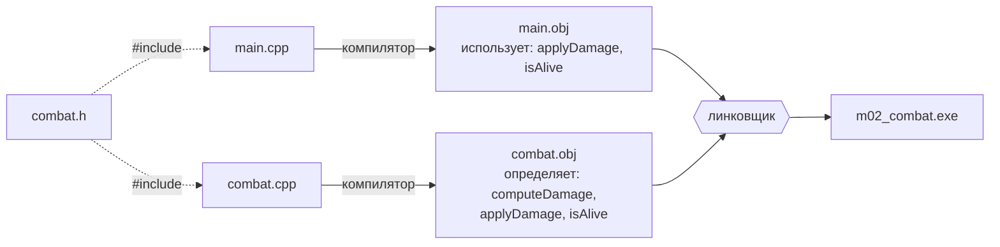

# 02.5 Многофайловые программы и линковщик

> [!abstract] О чём урок
> - как разделить программу на **заголовочные** (`.h`) и **исходные** (`.cpp`) файлы;
> - `#pragma once` и зачем он нужен;
> - **правило одного определения** (ODR) и что можно, а что нельзя писать в заголовках;
> - внутреннее и внешнее **связывание**, `inline`, `extern`;
> - разбираем настоящие ошибки линковщика: `LNK2019`, `LNK2005`, `C2011`;
> - **предварительные объявления** и гигиена заголовков.
>
> Здесь сходятся вместе все кусочки, рассыпанные по предыдущим урокам: [[00.2 Как исходник становится программой|этапы сборки]], [[02.1 Функции#Объявление и определение|объявление и определение]], декорированные имена. После урока ошибки линковщика перестанут быть магией.

## Зачем делить программу на файлы

- **Порядок.** Код боя — в одном файле, код карты — в другом, отрисовка — в третьем. Найти нужное проще.
- **Время сборки.** При изменении одного `.cpp` перекомпилируется только он, остальные `.obj` берутся готовыми. В проекте движка это разница между секундами и часами.
- **Повторное использование.** Файлы с математикой, вводом или логированием можно подключить в другой проект, а оформив библиотекой (следующий урок), не компилировать заново вообще.
- **Командная работа.** Два человека меньше мешают друг другу, работая в разных файлах.

## Заголовок и реализация

Вынесем «боевую систему» в отдельный модуль. Модуль в C++ — это пара файлов:

- **заголовочный файл** `combat.h` — **интерфейс**: что модуль умеет (объявления функций, определения типов);
- **исходный файл** `combat.cpp` — **реализация**: как он это делает (определения функций).

`combat.h`:
```cpp
#pragma once
#include <string>

struct Enemy {
    std::string name;
    int health = 100;
    int armor = 0;
};

int computeDamage(int baseDamage, int armor);
void applyDamage(Enemy& enemy, int baseDamage);
bool isAlive(const Enemy& enemy);
```

`combat.cpp`:
```cpp
#include "combat.h"

int computeDamage(int baseDamage, int armor) {
    int damage = baseDamage - armor;
    return damage > 1 ? damage : 1;
}

void applyDamage(Enemy& enemy, int baseDamage) {
    enemy.health -= computeDamage(baseDamage, enemy.armor);
}

bool isAlive(const Enemy& enemy) {
    return enemy.health > 0;
}
```

`main.cpp`:
```cpp
#include <print>
#include "combat.h"

int main() {
    Enemy baron{"Baron", 120, 15};
    int shots = 0;
    while (isAlive(baron)) {
        applyDamage(baron, 40);
        ++shots;
        std::println("Выстрел {}: у {} осталось {} здоровья", shots, baron.name, baron.health);
    }
}
```

Положи все три файла в папку `practice/m02_functions/combat_demo/` и добавь в `m02_functions/CMakeLists.txt` цель с **обоими** `.cpp`:

```cmake
add_executable(m02_combat combat_demo/main.cpp combat_demo/combat.cpp)
```

Заголовок в `add_executable` перечислять не обязательно: компилятор найдёт его по `#include "combat.h"` рядом с `.cpp`.

### Что происходит при сборке



1. Препроцессор вставляет текст `combat.h` и в `main.cpp`, и в `combat.cpp`.
2. Компилятор, обрабатывая `main.cpp`, видит **объявления** `applyDamage` и `isAlive`. Этого достаточно, чтобы проверить вызовы и сгенерировать инструкции `call` с «пустым» адресом. Тела функций ему не нужны.
3. Компилятор, обрабатывая `combat.cpp`, генерирует машинный код функций.
4. Линковщик видит, что `main.obj` **ссылается** на `applyDamage`, находит её **определение** в `combat.obj` и подставляет настоящий адрес.

> [!deep] Под капотом: таблицы символов
> Вот что показывает `dumpbin /symbols` для двух объектных файлов из похожего примера:
> ```
> combat.obj:  008 00000000 SECT3  notype ()  External | ?applyDamage@@YAXAEAUEnemy@@H@Z (void __cdecl applyDamage(struct Enemy &,int))
> main.obj:    00B 00000000 UNDEF  notype ()  External | ?applyDamage@@YAXAEAUEnemy@@H@Z (void __cdecl applyDamage(struct Enemy &,int))
> ```
> - В `combat.obj` символ лежит в секции `SECT3`: здесь он **определён**, тут его код.
> - В `main.obj` тот же символ помечен `UNDEF`: он **используется**, но не определён.
>
> Работа линковщика — сопоставить каждому `UNDEF` ровно одно определение. Нет ни одного — ошибка `LNK2019`. Больше одного — `LNK2005`. Вот и весь секрет.

## `#pragma once`

Первая строка заголовка — `#pragma once`. Она говорит препроцессору: «если этот файл уже вставлялся в текущую единицу трансляции, второй раз не вставляй».

Зачем? Заголовки подключают другие заголовки. Если `main.cpp` подключает `enemy.h` и `spawner.h`, а `spawner.h` сам подключает `enemy.h`, то без защиты определение `struct Enemy` окажется в `main.cpp` дважды:

```
error C2011: Enemy: переопределение типа "struct"
```

> [!tip] Пиши `#pragma once` в каждом заголовке
> Без исключений, первой строкой. В старом коде вместо неё используют **стражи включения** (include guards):
> ```cpp
> #ifndef EMBER_MATH_H
> #define EMBER_MATH_H
> // ... содержимое ...
> #endif
> ```
> Смысл тот же, но длиннее и можно ошибиться (скопировать заголовок и забыть поменять имя макроса). `#pragma once` формально не входит в стандарт, но его поддерживают все основные компиляторы.

## Правило одного определения

**ODR** (One Definition Rule) — главное правило многофайловых программ:

1. **Функции и глобальные переменные** определяются **ровно один раз во всей программе**. Объявлений может быть сколько угодно.
2. **Типы** (`struct`), **`inline`-функции и переменные** могут определяться в **нескольких** единицах трансляции, но все определения должны быть **одинаковыми** (обычно это достигается тем, что они живут в одном заголовке).

Отсюда правило для заголовков:

| В заголовке **можно** | В заголовке **нельзя** |
|---|---|
| Объявления функций: `int f(int);` | Определения обычных функций: `int f(int x) { ... }` |
| Определения типов: `struct Enemy { ... };` | Определения глобальных переменных: `int counter = 0;` |
| `constexpr`-константы: `constexpr int maxEnemies = 64;` | `using namespace ...;` |
| `inline`-функции и `inline`-переменные | |
| Шаблоны (модуль 10) | |

Почему нельзя определение функции? Заголовок вставляется в **каждый** `.cpp`, который его подключает. Если в нём тело функции, то каждый такой `.cpp` получит своё определение, и линковщик найдёт несколько.

## Ошибки линковщика: разбор

Я специально сломал пример четырьмя способами. Вот настоящие сообщения MSVC.

### 1. Забыли добавить `.cpp` в сборку

```cmake
add_executable(m02_combat combat_demo/main.cpp)   # где combat.cpp?
```

```
main.obj : error LNK2019: ссылка на неразрешенный внешний символ "void __cdecl applyDamage(struct Enemy &,int)" (?applyDamage@@YAXAEAUEnemy@@H@Z) в функции main.
main.obj : error LNK2019: ссылка на неразрешенный внешний символ "bool __cdecl isAlive(struct Enemy const &)" (?isAlive@@YA_NAEBUEnemy@@@Z) в функции main.
v1.exe : fatal error LNK1120: неразрешенных внешних элементов: 2
```

Компилятор поверил объявлениям из заголовка, а определений линковщик не нашёл. Обрати внимание: про `computeDamage` ошибки нет, потому что `main` её не вызывает.

**Диагноз по LNK2019:** функция объявлена, вызвана, но её определение не попало в сборку. Проверь: есть ли тело функции? Добавлен ли `.cpp` в `add_executable`? Подключена ли библиотека через `target_link_libraries`?

### 2. Сигнатуры объявления и определения не совпадают

В заголовке `void applyDamage(Enemy& enemy, int baseDamage);`, а в `combat.cpp` по ошибке `void applyDamage(Enemy& enemy, float baseDamage) { ... }`:

```
main.obj : error LNK2019: ссылка на неразрешенный внешний символ "void __cdecl applyDamage(struct Enemy &,int)" (?applyDamage@@YAXAEAUEnemy@@H@Z) в функции main.
```

Для компилятора это **две разные перегрузки**: `applyDamage(Enemy&, int)` объявлена, но не определена, а `applyDamage(Enemy&, float)` определена, но никем не используется. Компилятор не ругается, ведь перегрузка законна. Ошибку находит только линковщик. Сравни декорированное имя в сообщении с тем, что написано в `.cpp`: разница всегда в типах параметров.

### 3. Тело функции в заголовке

`util.h`:
```cpp
#pragma once
int clampHealth(int h) {
    return h < 0 ? 0 : h;
}
```
Если этот заголовок подключён в двух `.cpp`:

```
a.obj : error LNK2005: "int __cdecl clampHealth(int)" (?clampHealth@@YAHH@Z) уже определен в main.obj
main.exe : fatal error LNK1169: обнаружен многократно определенный символ - один или более
```

`#pragma once` здесь **не помогает**: он защищает от повторной вставки в **одну** единицу трансляции, а у нас две разные. Каждая получила своё определение.

Два способа исправить:
- перенести тело в `.cpp`, оставив в заголовке объявление;
- пометить функцию `inline` (см. ниже).

### 4. Глобальная переменная в заголовке

`stats.h`:
```cpp
#pragma once
int frameCount = 0;
```
```
a.obj : error LNK2005: "int frameCount" (?frameCount@@3HA) уже определен в main.obj
```

Та же проблема, что с функцией. Исправления — в разделе про `extern` и `inline` ниже.

## Связывание — внутреннее и внешнее

**Связывание** (linkage) определяет, видно ли имя **из других единиц трансляции**:

| Связывание | Что значит | Что его имеет |
|---|---|---|
| **Внешнее** (external) | Имя видно линковщику и общее для всей программы | Обычные функции, глобальные переменные (не `const`) |
| **Внутреннее** (internal) | Имя видно только в своей единице трансляции | Всё в безымянном `namespace { }`, функции и переменные со `static`, глобальные `const` и `constexpr` переменные |

Внутреннее связывание означает, что у каждого `.cpp` будет **своя** копия, и линковщик их не сравнивает. Поэтому:

```cpp
// В заголовке — можно: constexpr даёт внутреннее связывание, каждый .cpp получит свою константу
constexpr int maxEnemies = 64;
```

А вспомогательные функции, которые нужны только внутри одного `.cpp`, стоит прятать в безымянное пространство имён:

```cpp
// combat.cpp
namespace {
    int randomBonus() { ... }   // деталь реализации: другие файлы её не увидят
}
```

Так эти функции не конфликтуют с одноимёнными функциями в других файлах, а компилятор, зная, что их никто снаружи не вызывает, может их агрессивнее оптимизировать.

### `inline`: разрешение на несколько определений

Ключевое слово `inline` у функции или переменной говорит линковщику: «определений будет несколько, все одинаковые, оставь любое одно».

```cpp
// util.h
#pragma once

inline int clampHealth(int h) {      // теперь можно в заголовке
    return h < 0 ? 0 : h;
}

inline int frameCount = 0;           // C++17: одна общая переменная на всю программу
```

Несмотря на название, `inline` в современном C++ — про правила линковки, а **не** про встраивание кода (это компилятор решает сам, [[02.2 Как работает вызов — стек и рекурсия#Встраивание функций|урок 02.2]]). Хотя исторически слово появилось именно ради встраивания: чтобы встроить функцию, её тело должно быть в заголовке, а чтобы тело было в заголовке, нужно разрешить несколько определений.

> [!deep] Под капотом: COMDAT
> Как линковщик выбирает «любое одно»? Компилятор помещает каждую `inline`-функцию в отдельную секцию особого вида: **COMDAT** (ты видел пометку `; COMDAT` в ассемблерных листингах урока 02.2). Встретив несколько COMDAT-секций с одинаковым именем, линковщик берёт одну, а остальные выбрасывает. Он **не проверяет**, что они одинаковые. Если два `.cpp` определят разные `inline`-функции с одинаковым именем (например, по-разному настроив макросы перед `#include`), программа соберётся, а какая версия попадёт в `.exe`, решит случай. Это нарушение ODR, и оно не диагностируется: ещё одна разновидность UB.

### `extern`: объявление переменной

Классический способ сделать глобальную переменную общей для нескольких файлов — **объявить** её в заголовке словом `extern`, а **определить** в одном `.cpp`:

```cpp
// stats.h
#pragma once
extern int frameCount;      // объявление: «где-то есть такая переменная»

// stats.cpp
#include "stats.h"
int frameCount = 0;         // определение: ровно одно
```

С C++17 `inline int frameCount = 0;` в заголовке делает то же самое короче. Но лучше всего — вообще не иметь изменяемых глобальных переменных ([[02.4 Области видимости, время жизни и пространства имён#Глобальные переменные|урок 02.4]]).

## Предварительные объявления

Чтобы использовать тип **по ссылке** (или по указателю), компилятору не нужно знать его устройство. Достаточно знать, что он **существует**:

```cpp
// renderer.h
#pragma once

struct Enemy;   // предварительное объявление (forward declaration): «есть такой тип»

void drawEnemy(const Enemy& enemy);   // достаточно: ссылка — это просто адрес
```

Заголовок `renderer.h` больше не обязан подключать `combat.h`. Какая разница? Каждый `#include` — это тысячи строк, которые компилятор разбирает в **каждом** `.cpp`, где подключён `renderer.h`. И при изменении `combat.h` теперь не нужно перекомпилировать всё, что подключает `renderer.h`.

Полное определение типа нужно, когда компилятор должен знать его **размер** или **поля**: создать объект, передать по значению, обратиться к `enemy.health`. Это происходит в `renderer.cpp`, и там уже подключается `combat.h`.

> [!engine] Гигиена заголовков в больших проектах
> В движке на миллионы строк время сборки — постоянная головная боль, и вот правила, которые там соблюдают:
> - **Заголовок подключает только то, что нужно ему самому.** Всё, что можно, заменяется предварительными объявлениями.
> - **Заголовок самодостаточен**: его можно подключить первым в пустой `.cpp`, и он скомпилируется. Чтобы это проверялось автоматически, каждый `.cpp` подключает **свой** заголовок **первым** (как `combat.cpp` подключает `combat.h`).
> - **Тяжёлые заголовки стандартной библиотеки** (`<format>`, `<iostream>`, `<regex>`) не подключаются в публичные заголовки движка без крайней необходимости.
> - Для оставшегося — **предкомпилированные заголовки** и **unity builds** ([[00.2 Как исходник становится программой#Почему C++ компилируется долго и что с этим делают|урок 00.2]]).

> [!deep] А как же модули C++20?
> C++20 предложил замену всей этой системе — **модули**:
> ```cpp
> // combat.ixx
> export module combat;
> export int computeDamage(int baseDamage, int armor) { ... }
>
> // main.cpp
> import combat;
> ```
> Модуль компилируется один раз в бинарное описание интерфейса, текстовых вставок нет, и макросы не протекают. MSVC поддерживает модули лучше остальных компиляторов, CMake — с версии 3.28. Но экосистема ещё в процессе перехода: часть инструментов (включая IntelliSense) работает с модулями неуверенно, а в существующем коде движков их нет. Поэтому в курсе мы используем заголовки, а к модулям, возможно, вернёмся в конце как к эксперименту.

> [!try] Попробуй сам
> 1. Собери `m02_combat` из трёх файлов урока. Затем по очереди воспроизведи все четыре ошибки из раздела «Ошибки линковщика: разбор» и прочитай сообщения.
> 2. Убери `#pragma once` из `combat.h` и подключи его в `main.cpp` дважды подряд. Какая ошибка?
> 3. Добавь в `combat.cpp` функцию `randomBonus()` внутри безымянного пространства имён и попробуй вызвать её из `main.cpp` (объявив `int randomBonus();` в `main.cpp`). На каком этапе ошибка?
> 4. Создай заголовок `log.h` с функцией `inline void logInfo(const std::string& text)` и подключи его в `main.cpp` и `combat.cpp`. Убедись, что ошибки `LNK2005` нет. Затем убери `inline` и проверь, что она появилась.

> [!quiz]- Проверь себя
> 1. Что обычно лежит в `.h`, а что в `.cpp`?
> 2. От чего защищает `#pragma once`, а от чего — нет?
> 3. Сформулируй правило одного определения.
> 4. Ты видишь `LNK2019` про функцию, которая точно написана в `combat.cpp`. Назови две вероятные причины.
> 5. Почему `constexpr int maxEnemies = 64;` в заголовке не вызывает `LNK2005`, а `int maxEnemies = 64;` вызывает?
> 6. Что означает `inline` у функции в современном C++?
> 7. Когда достаточно предварительного объявления `struct Enemy;`, а когда нужно подключить полное определение?
>
> > [!success]- Ответы
> > 1. В `.h` — интерфейс: объявления функций, определения типов, константы, `inline`-функции. В `.cpp` — определения функций и переменных.
> > 2. Защищает от повторной вставки заголовка в **одну** единицу трансляции (ошибка C2011). Не защищает от того, что определение функции или переменной из заголовка попадёт в **несколько** единиц трансляции (ошибка LNK2005).
> > 3. Функции и переменные определяются ровно один раз во всей программе; типы и `inline`-сущности могут определяться в нескольких единицах трансляции, но одинаково.
> > 4. `combat.cpp` не добавлен в цель CMake; сигнатура определения отличается от объявления (другой тип параметра, `const`) — тогда это другая перегрузка.
> > 5. Глобальные `constexpr` (и `const`) переменные имеют внутреннее связывание: у каждого `.cpp` своя копия, линковщик их не сравнивает. Обычная глобальная переменная имеет внешнее связывание, и определений получается несколько.
> > 6. «Определений может быть несколько, они одинаковые, возьми любое». Встраивание решает компилятор независимо от этого слова.
> > 7. Предварительного объявления достаточно, если тип используется только по ссылке или указателю (в объявлениях функций, полях-указателях). Полное определение нужно, чтобы создать объект, узнать его размер, передать по значению или обратиться к полям.

> [!interview] Вопрос с собеседования
> **«Что будет, если определить функцию в заголовочном файле?»** Ответ: если заголовок подключён в нескольких `.cpp`, будет ошибка линковки «multiple definition» (`LNK2005`), потому что нарушено ODR. Исправления: вынести определение в `.cpp`, сделать функцию `inline`, сделать её `static` или поместить в безымянное пространство имён (тогда у каждого `.cpp` будет своя копия, что раздувает код). Хороший ответ упоминает, почему `#pragma once` тут не помогает.

---
[[02.4 Области видимости, время жизни и пространства имён|← Области видимости и пространства имён]] · [[🏠 Главная|🏠]] · [[02.6 CMake — библиотеки и структура проекта|Далее: CMake — библиотеки →]]
