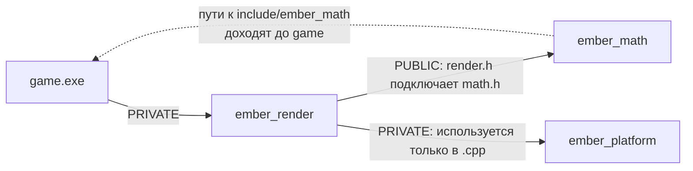

# 02.6 CMake — библиотеки и структура проекта

> [!abstract] О чём урок
> - статическая библиотека: `add_library`, `target_include_directories`, `target_link_libraries`;
> - `PUBLIC`, `PRIVATE`, `INTERFACE`: как свойства целей передаются по цепочке зависимостей;
> - структура папок библиотеки: `include/` и `src/`;
> - **рождение движка Ember**: первая версия его математической библиотеки;
> - что внутри `.lib` и почему мы не делаем DLL.

## Библиотека в CMake

До сих пор каждая наша цель была программой (`add_executable`). Но код, который нужен **нескольким** программам (математика, ввод, логирование), разумно собрать один раз в **библиотеку** и подключать к программам.

```cmake
add_library(ember STATIC src/math.cpp)
```

- `add_library(имя тип исходники...)` создаёт цель-библиотеку.
- `STATIC` — статическая библиотека: архив `.obj`-файлов, из которого линковщик копирует нужный код в каждую программу ([[00.2 Как исходник становится программой#Библиотеки|урок 00.2]]).
- У библиотеки нет `main`: это не программа, её нельзя запустить.

Подключение библиотеки к программе:

```cmake
add_executable(m02_ember_demo ember_demo.cpp)
target_link_libraries(m02_ember_demo PRIVATE ember)
```

`target_link_libraries` делает **две** вещи сразу:
1. говорит линковщику добавить `ember.lib` при сборке `m02_ember_demo.exe`;
2. передаёт программе **требования использования** (usage requirements) библиотеки: пути к её заголовкам, нужные флаги и определения.

Второй пункт — главная сила современного CMake, о нём ниже.

## Структура библиотеки

Принятая раскладка файлов:

```
practice/
├── CMakeLists.txt              ← add_subdirectory(ember) раньше модулей курса
├── ember/                      ← движок
│   ├── CMakeLists.txt
│   ├── include/
│   │   └── ember/
│   │       └── math.h          ← ПУБЛИЧНЫЕ заголовки: интерфейс движка
│   └── src/
│       └── math.cpp            ← реализация (и приватные заголовки, если появятся)
└── m02_functions/
    ├── CMakeLists.txt
    └── ember_demo.cpp          ← программа, которая использует движок
```

Зачем лишняя папка `include/ember/`? Чтобы в коде пользователя подключение выглядело так:

```cpp
#include <ember/math.h>
```

Имя библиотеки в пути работает как пространство имён для файлов: если у другой библиотеки тоже есть `math.h`, путаницы не будет. Так устроены почти все C++ библиотеки.

> [!tip] Кавычки или угловые скобки?
> Для заголовков **своего же** модуля (лежащих рядом) пиши кавычки: `#include "combat.h"`. Для заголовков **библиотек**, найденных через пути поиска (стандартная библиотека, Ember), — угловые скобки: `#include <ember/math.h>`. Технически сработает и то и другое; это соглашение о том, что видит читатель: «это наше» или «это из библиотеки».

## Рождение Ember

Создадим движок. Пока в нём одна вещь: двумерный вектор `Vec2` и четыре функции для него. В практикуме ты расширишь его до полноценной библиотеки 2D-математики с тестами.

`practice/ember/include/ember/math.h`:
```cpp
#pragma once

namespace ember {

// Двумерный вектор: точка на плоскости или направление
struct Vec2 {
    float x = 0.0f;
    float y = 0.0f;
};

Vec2 add(Vec2 a, Vec2 b);
Vec2 sub(Vec2 a, Vec2 b);
Vec2 scale(Vec2 v, float factor);
float length(Vec2 v);

}  // namespace ember
```

`practice/ember/src/math.cpp`:
```cpp
#include <ember/math.h>

#include <cmath>

namespace ember {

Vec2 add(Vec2 a, Vec2 b) {
    return {a.x + b.x, a.y + b.y};
}

Vec2 sub(Vec2 a, Vec2 b) {
    return {a.x - b.x, a.y - b.y};
}

Vec2 scale(Vec2 v, float factor) {
    return {v.x * factor, v.y * factor};
}

float length(Vec2 v) {
    return std::sqrt(v.x * v.x + v.y * v.y);
}

}  // namespace ember
```

Обрати внимание:
- `math.cpp` подключает **свой** заголовок **первым**: так мы проверяем, что заголовок самодостаточен ([[02.5 Многофайловые программы и линковщик#Предварительные объявления|урок 02.5]]).
- `<cmath>` нужен только реализации, поэтому подключён в `.cpp`, а не в заголовке. Пользователи Ember не платят за него временем компиляции.
- `return {a.x + b.x, a.y + b.y};` — компилятор знает, что функция возвращает `Vec2`, поэтому `{...}` создаёт `Vec2` из двух значений.
- `Vec2` передаётся **по значению**: 8 байт, передаются в регистре ([[02.3 Ссылки и передача параметров#Как выбрать|урок 02.3]]).

`practice/ember/CMakeLists.txt`:
```cmake
add_library(ember STATIC
    src/math.cpp
)

# Публичные заголовки: нужны и самому движку, и всем, кто его использует
target_include_directories(ember PUBLIC include)
```

В главном `practice/CMakeLists.txt` подключи движок **перед** модулями курса (порядок важен: цель `ember` должна существовать к моменту, когда модули на неё сошлются):

```cmake
# ---------- Движок ----------
add_subdirectory(ember)

# ---------- Модули курса ----------
add_subdirectory(m00_setup)
add_subdirectory(m01_basics)
add_subdirectory(m02_functions)
```

Программа-пример `practice/m02_functions/ember_demo.cpp`:
```cpp
#include <ember/math.h>

#include <print>

int main() {
    ember::Vec2 position{0.0f, 0.0f};
    ember::Vec2 velocity{3.0f, 4.0f};   // единиц в секунду
    const float dt = 0.5f;              // полсекунды

    for (int step = 1; step <= 4; ++step) {
        position = ember::add(position, ember::scale(velocity, dt));
        std::println("Шаг {}: позиция ({:.1f}, {:.1f}), пройдено {:.1f}",
                     step, position.x, position.y, ember::length(position));
    }
}
```

И в `practice/m02_functions/CMakeLists.txt`:
```cmake
add_executable(m02_ember_demo ember_demo.cpp)
target_link_libraries(m02_ember_demo PRIVATE ember)
```

Собери (`F7`) и запусти `m02_ember_demo`:

```
Шаг 1: позиция (1.5, 2.0), пройдено 2.5
Шаг 2: позиция (3.0, 4.0), пройдено 5.0
Шаг 3: позиция (4.5, 6.0), пройдено 7.5
Шаг 4: позиция (6.0, 8.0), пройдено 10.0
```

Посмотри на сборку в Output: сначала строка `ember.vcxproj -> ...\build\ember\Debug\ember.lib`, потом программа. CMake знает, что программа зависит от библиотеки, и собирает их в правильном порядке.

> [!question] Откуда программа узнала, где лежит `ember/math.h`?
> Мы нигде не писали `target_include_directories` для `m02_ember_demo`. Путь `ember/include` пришёл к программе **вместе с библиотекой**, через `target_link_libraries`, потому что он объявлен как `PUBLIC`. Это и есть требования использования.

## `PUBLIC`, `PRIVATE`, `INTERFACE`

Каждое свойство цели (пути заголовков, флаги, библиотеки) можно объявить с одним из трёх слов:

| Слово | Нужно самой цели? | Передаётся тем, кто от неё зависит? |
|---|---|---|
| `PRIVATE` | да | нет |
| `INTERFACE` | нет | да |
| `PUBLIC` | да | да |

Как выбрать:
- **Путь к публичным заголовкам** библиотеки — `PUBLIC`: библиотека сама их подключает, и пользователи тоже.
- **Путь к внутренним заголовкам** (в `src/`) — `PRIVATE`: пользователям они не нужны.
- **Зависимость от другой библиотеки** — `PRIVATE`, если она используется только в `.cpp`, и `PUBLIC`, если её заголовки подключаются в **твоих публичных заголовках** (тогда пользователям нужны и её пути).
- `INTERFACE` — для **библиотек из одних заголовков** (header-only), у которых нечего компилировать: `add_library(name INTERFACE)`.



Если `ember_render` подключает `ember_math` как `PUBLIC`, то программа `game`, подключив только `ember_render`, автоматически получит пути к заголовкам `ember_math`, и это правильно: её код подключит `render.h`, а тот подключит `math.h`. А `ember_platform` спрятан: `game` не видит его заголовков и не может случайно начать от него зависеть.

> [!engine] Направление зависимостей
> В движке зависимости идут **в одну сторону**: игра зависит от движка, высокоуровневые модули движка (рендер, звук) — от низкоуровневых (математика, память, платформа). **Никогда наоборот.** Если `math` начнёт подключать `render`, получится цикл, и любое изменение будет пересобирать всё. CMake с `PRIVATE`/`PUBLIC` делает эти зависимости явными и проверяемыми. В Unreal Engine такая же система: каждый модуль (`Core`, `Engine`, `Renderer`…) в своём файле `.Build.cs` перечисляет публичные и приватные зависимости, и это прямой аналог `target_link_libraries`.

## Под капотом: что внутри `.lib`

> [!deep] Статическая библиотека — это архив
> Утилита `lib` из Developer PowerShell показывает содержимое:
> ```
> > lib /list build\ember\Debug\ember.lib
> ember.dir\Debug\math.obj
> ```
> Внутри просто объектный файл, тот же `.obj`, что получился бы без библиотеки. А `dumpbin /symbols` показывает определённые в нём функции:
> ```
> 00E 00000000 SECT4 notype () External | ?add@ember@@YA?AUVec2@1@U21@0@Z (struct ember::Vec2 __cdecl ember::add(struct ember::Vec2,struct ember::Vec2))
> 011 000000F0 SECT4 notype () External | ?length@ember@@YAMUVec2@1@@Z (float __cdecl ember::length(struct ember::Vec2))
> ```
> Видишь `@ember@@` в декорированном имени? Пространство имён — тоже часть имени символа. Поэтому `ember::length` и `std::length` (если бы такая была) не конфликтуют и для линковщика.
>
> Линковщик берёт из `.lib` только те `.obj`, символы которых **реально используются** программой. Если в библиотеке 100 файлов, а программа вызывает одну функцию, в `.exe` попадёт один `.obj`. Поэтому в больших библиотеках код раскладывают по многим маленьким `.cpp`.

### Почему не DLL

Можно было бы написать `add_library(ember SHARED ...)` и получить динамическую библиотеку `ember.dll`. Но в Windows это добавляет хлопот:
- по умолчанию из DLL **ничего не экспортируется**: каждую функцию нужно пометить `__declspec(dllexport)` при сборке DLL и `__declspec(dllimport)` при использовании, обычно через макрос вида `EMBER_API`;
- DLL должна лежать рядом с `.exe` (или в путях поиска), иначе программа не запустится;
- нельзя встроить функцию из DLL в вызывающий код: оптимизатор её не видит.

> [!engine] DLL в движках
> Unreal Engine в режиме редактора собирает каждый модуль отдельной DLL: так быстрее пересобирать отдельные части и можно перезагружать код игры, не закрывая редактор (hot reload). А в финальной сборке для игроков всё собирается **монолитно**, статически, в один `.exe`: так быстрее и надёжнее. Нам hot reload пока не нужен, и Ember будет статической библиотекой.

## Итоговая структура проекта

После этого урока `practice/` выглядит так (папки `build` и `.vscode` не показаны):

```
practice/
├── CMakeLists.txt
├── CMakePresets.json
├── ember/
│   ├── CMakeLists.txt
│   ├── include/ember/math.h
│   └── src/math.cpp
├── m00_setup/
├── m01_basics/
└── m02_functions/
    ├── CMakeLists.txt
    ├── combat_demo/        ← из урока 02.5
    └── ember_demo.cpp
```

Главный `CMakeLists.txt` целиком:

```cmake
cmake_minimum_required(VERSION 3.30)
project(CppJourney LANGUAGES CXX)

set(CMAKE_CXX_STANDARD 23)
set(CMAKE_CXX_STANDARD_REQUIRED ON)
set(CMAKE_CXX_EXTENSIONS OFF)

set(CMAKE_RUNTIME_OUTPUT_DIRECTORY ${CMAKE_BINARY_DIR}/bin)

if(MSVC)
    add_compile_options(/W4 /permissive- /utf-8 /Zc:__cplusplus)
endif()

# ---------- Движок ----------
add_subdirectory(ember)

# ---------- Модули курса ----------
add_subdirectory(m00_setup)
add_subdirectory(m01_basics)
add_subdirectory(m02_functions)
```

> [!warning] Не используй `file(GLOB ...)` для исходников
> В интернете часто советуют собирать список файлов автоматически: `file(GLOB SOURCES src/*.cpp)`. Проблема в том, что список вычисляется при **конфигурации**: добавишь новый `.cpp`, а CMake о нём не узнает, пока не переконфигурируешь проект вручную. Сборка «молча» не включит новый файл, и ты получишь `LNK2019`. Официальная рекомендация CMake — перечислять исходники явно. Это пара строк, зато список под контролем.

> [!try] Попробуй сам
> 1. Создай `ember` и `m02_ember_demo` по уроку, собери и запусти.
> 2. Поменяй `PUBLIC` на `PRIVATE` в `target_include_directories(ember ...)`, сохрани и собери. Какая ошибка появилась в `ember_demo.cpp` и почему?
> 3. Убери `target_link_libraries(m02_ember_demo PRIVATE ember)`. Какая теперь ошибка? На каком этапе?
> 4. Добавь в Ember функцию `float dot(Vec2 a, Vec2 b)` (скалярное произведение: `a.x * b.x + a.y * b.y`) и вызови её из демо. Какие файлы пришлось изменить?
> 5. Открой Developer PowerShell и выполни `lib /list` для своего `ember.lib`.

> [!quiz]- Проверь себя
> 1. Чем `add_library(... STATIC ...)` отличается от `add_executable`?
> 2. Какие две вещи делает `target_link_libraries`?
> 3. Когда путь к заголовкам нужно объявлять `PUBLIC`, а когда `PRIVATE`?
> 4. Библиотека `render` в своих публичных заголовках подключает `<ember/math.h>`. Как правильно связать `render` с `ember`?
> 5. Почему публичные заголовки кладут в `include/ember/`, а не прямо в `include/`?
> 6. Попадёт ли в `.exe` код функции из статической библиотеки, которую программа не вызывает?
> 7. Почему `file(GLOB)` для исходников — плохая идея?
>
> > [!success]- Ответы
> > 1. Библиотека — набор скомпилированного кода без `main`, который подключается к программам. Программа — запускаемый `.exe`.
> > 2. Добавляет библиотеку на этапе линковки и передаёт цели требования использования библиотеки (публичные пути заголовков, флаги, зависимости).
> > 3. `PUBLIC` — если заголовки нужны и самой библиотеке, и её пользователям (публичный интерфейс). `PRIVATE` — внутренние заголовки, нужные только реализации.
> > 4. `target_link_libraries(render PUBLIC ember)`: пользователи `render` тоже должны видеть заголовки `ember`.
> > 5. Чтобы подключать их как `<ember/math.h>`: имя библиотеки в пути защищает от конфликтов одинаковых имён файлов из разных библиотек.
> > 6. Нет (если функция лежит в отдельном `.obj`, который больше ничем не используется): линковщик берёт из `.lib` только нужные объектные файлы.
> > 7. Список файлов вычисляется при конфигурации, и новые файлы не попадут в сборку, пока проект не переконфигурируют.

---
[[02.5 Многофайловые программы и линковщик|← Многофайловые программы]] · [[🏠 Главная|🏠]] · [[Практикум 02 — Функции и первый кирпич движка|Далее: Практикум 02 →]]
