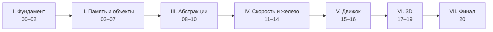

# C++: от нуля до своего движка

> [!abstract] О курсе
> Курс учит **C++ с нуля** и ведёт к конкретной цели: понять, как устроены **игровые движки**, и написать свой маленький движок.
> Финал: **ретро-шутер в духе Doom** на собственном движке. У движка два рендера с общим интерфейсом: **программный** (каждый пиксель считает наш код на CPU) и **Direct3D 11** (видеокарта). Игра пишется один раз, а рендер переключается клавишей прямо во время игры.
>
> Правила игры:
> - только **C++** и его **стандартная библиотека**; никаких движков и сторонних библиотек;
> - из «чужого» только то, что уже есть в Windows: **WinAPI** для окна, клавиатуры и звука и **Direct3D 11** в финале;
> - редактор **VS Code**, компилятор **MSVC** (из Visual Studio 2026), сборка **CMake**;
> - стандарт **C++23**.

> [!tip] С чего начать
> 1. Прочитай [[Как проходить курс]]: там легенда цветных блоков и порядок работы.
> 2. Открой [[00.1 Что такое C++ и почему движки пишут на нём]] и иди по порядку.
> 3. Отмечай пройденные уроки галочкой `done` в свойствах заметки (вверху страницы). Общая таблица прогресса: [[📊 Прогресс.base|📊 Прогресс]].

## Карта курса

Сквозной проект курса: движок **Ember**. Он начинается в практикуме модуля 02 как крошечная библиотека математики и с каждым модулем обрастает новыми частями: окно и игровой цикл, профайлер, аллокаторы, ECS, job system, ресурсы, отладочный интерфейс, два рендера. Игры из практикумов тоже постепенно переезжают на него. С модуля 07 у нас есть окно с пикселями, и практикумы становятся графическими.

> [!info] Условные обозначения
> ✅ модуль готов и ждёт тебя · 🚧 модуль в работе · ⬜ модуль запланирован.
> План последних модулей может уточняться по ходу курса.

---

## Часть I. Фундамент

### ✅ Модуль 00. Инструменты
Как C++ превращается в программу, настройка VS Code + MSVC + CMake, отладчик.
- [[00.1 Что такое C++ и почему движки пишут на нём]]
- [[00.2 Как исходник становится программой]]
- [[00.3 Установка и проверка инструментов]]
- [[00.4 CMake с нуля]]
- [[00.5 Проект курса в VS Code]]
- [[00.6 Отладчик — главный инструмент]]
- 🎯 [[Практикум 00 — Инструменты]]

### ✅ Модуль 01. Основы языка
Типы, операторы, биты, ветвления и циклы, ввод-вывод, первые составные типы.
- [[01.1 Анатомия программы]]
- [[01.2 Переменные и фундаментальные типы]]
- [[01.3 Операторы, выражения и преобразования]]
- [[01.4 Биты и байты]]
- [[01.5 Управление потоком]]
- [[01.6 Ввод, вывод, строки и случайность]]
- [[01.7 Первые составные типы — array, vector, struct]]
- 🎯 [[Практикум 01 — Основы]]

### ✅ Модуль 02. Функции и организация кода
Функции и стек вызовов, ссылки, области видимости, многофайловые проекты, библиотеки в CMake. Рождение движка Ember.
- [[02.1 Функции]]
- [[02.2 Как работает вызов — стек и рекурсия]]
- [[02.3 Ссылки и передача параметров]]
- [[02.4 Области видимости, время жизни и пространства имён]]
- [[02.5 Многофайловые программы и линковщик]]
- [[02.6 CMake — библиотеки и структура проекта]]
- 🎯 [[Практикум 02 — Функции и первый кирпич движка]]

---

## Часть II. Память и объекты
*Сердце C++: то, чего нет в C#, Python и Go, и то, ради чего движки пишут на C++.*

### ⬜ Модуль 03. Память и указатели
Карта памяти процесса · указатели · массивы и арифметика указателей · куча: `new`/`delete` · неопределённое поведение и AddressSanitizer · сырые байты и `memcpy`.
🎯 *Практикум:* свой динамический массив, охота на утечки и выходы за границы.

### ⬜ Модуль 04. Классы и RAII
От `struct` к `class` · конструкторы и деструкторы · RAII · const-корректность · перегрузка операторов (`Vec2`, `Color`) · `enum class` и битовые флаги.
🎯 *Практикум:* математика Ember на классах, RAII-таймер.

### ⬜ Модуль 05. Копирование, перемещение, владение
Правило трёх · lvalue и rvalue · семантика перемещения · правило нуля и пяти · `unique_ptr` · `shared_ptr`/`weak_ptr` · пишем свой `vector`.

### ⬜ Модуль 06. Стандартная библиотека
Как устроены контейнеры · хеш-таблицы · итераторы · лямбды · алгоритмы и ranges · `string_view` и `span` · файлы, `<filesystem>`, `<chrono>`.

### ⬜ Модуль 07. Первое окно
Окно Ember как готовый «чёрный ящик» (устройство разберём в модуле 15) · framebuffer: массив пикселей и формат BGRA · игровой цикл и время кадра · клавиатура в реальном времени · рисуем точки, линии, прямоугольники.
🎯 *Практикум:* Змейка, «Жизнь» в окне, Pong, звёздное небо из частиц.

---

## Часть III. Абстракции

### ⬜ Модуль 08. Наследование и полиморфизм
Наследование · виртуальные функции и vtable под капотом · интерфейсы · цена полиморфизма · `std::variant` · композиция против наследования.

### ⬜ Модуль 09. Ошибки и надёжность
Исключения и раскрутка стека · гарантии безопасности · `optional` и `expected` · ассерты и логирование в движке · свой мини-фреймворк тестов + CTest.

### ⬜ Модуль 10. Шаблоны и вычисления при компиляции
Шаблоны функций и классов · специализация и type traits · variadic templates · концепты · `constexpr`/`consteval` · CRTP.

---

## Часть IV. Скорость и железо
*То, что отличает программиста движков от просто C++-программиста.*

### ⬜ Модуль 11. Как работает железо
CPU, кэш и задержки памяти · выравнивание и раскладка объектов · что делает оптимизатор · читаем ассемблер · SIMD · **свой профайлер** с выводом в Chrome Tracing.
🎯 *Практикум:* 100 000 частиц в окне и охота за миллисекундами.

### ⬜ Модуль 12. Память движка
Зачем движкам свои аллокаторы · арена · стековый и пул-аллокатор · `placement new` · `std::pmr` · хэндлы вместо указателей.

### ⬜ Модуль 13. Data-oriented design и ECS
AoS против SoA · сущности, компоненты, системы · sparse set · свой ECS.

### ⬜ Модуль 14. Многопоточность
Потоки · гонки и мьютексы · атомики и модель памяти · очереди и `condition_variable` · пул потоков · job system.

---

## Часть V. Движок

### ⬜ Модуль 15. Платформенный слой и архитектура
Разбираем окно из модуля 07: WinAPI, цикл сообщений, вывод кадра · мышь и геймпад · таймеры высокой точности · игровой цикл с фиксированным шагом · подсистемы движка и порядок их запуска · менеджер ресурсов и горячая перезагрузка ассетов.

### ⬜ Модуль 16. 2D-рендер и инструменты
Спрайты и прозрачность · читаем BMP сами · растровый шрифт и HUD · **свой отладочный интерфейс** (immediate-mode UI) · внутриигровая консоль · звук через WinAPI.
🎯 *Практикум:* 2D-игра на Ember.

---

## Часть VI. 3D

### ⬜ Модуль 17. 3D-математика
Векторы и матрицы · преобразования и иерархии · камера, вид и проекция · однородные координаты · кватернионы.
🎁 *Бонус:* рейкастер в стиле Wolfenstein 3D за один вечер.

### ⬜ Модуль 18. Программный растеризатор
Конвейер рендера · растеризация треугольников · z-буфер · отсечение · текстуры с перспективной коррекцией · освещение · загрузка моделей OBJ · **интерфейс бэкенда рендера** в Ember.

### ⬜ Модуль 19. Direct3D 11 — второй рендер
Как устроен GPU · COM и `ComPtr` · устройство и swap chain · буферы и шейдеры HLSL · константные буферы · текстуры · реализация того же интерфейса рендера на видеокарте · сравнение кадров двух рендеров.

---

## Часть VII. Финал

### ⬜ Модуль 20. Ретро-шутер на Ember
Архитектура игры · уровни-сетки с высотами пола и потолка → 3D-меши · столкновения с уровнем · враги-спрайты на конечных автоматах · оружие и попадания · двери, ключи, триггеры · **редактор уровней** на своём UI · звук, меню, сохранения · профилирование и полировка · переключение CPU/GPU-рендера на лету.
🏁 *Итог:* своя игра на своём движке.

---

## Справочник
- [[Глоссарий]]: все термины курса в одном месте.
- [[Шпаргалка — CMake]]
- [[Шпаргалка — VS Code и отладка]]
- [[Частые ошибки MSVC]]
